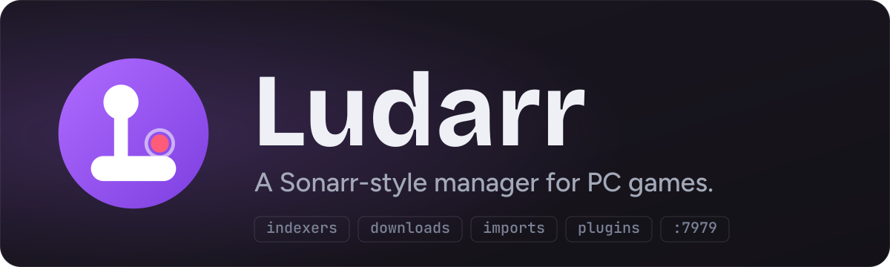
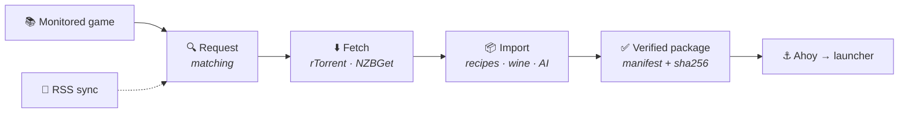

<div align="center">



<br>

**Monitor games, search your indexers, download, and turn every finished download into a verified, installable folder.**

[](https://bun.sh)
[](https://hono.dev)
[](https://vite.dev)
[](https://bun.sh/docs/api/sqlite)
[](#-run)
[](#-writing-a-plugin)

[Features](#-features) · [Pipeline](#-the-pipeline) · [Run](#-run) · [Layout](#-layout) · [Plugins](#-writing-a-plugin)

</div>

---

> **Formerly playarr, then arcadearr.** A server set up under the old name keeps working as it is: what it has under
> that name is still read (`src/former.ts`). Player-facing things (accounts, friends, discovery, the desktop
> app) live in **[Ahoy](https://github.com/robertson-dev/ahoy)**, which is this engine's only client.

## ✨ Features

| | |
|---|---|
| 📚 **Library** | Games you monitor, each with a profile (which formats to accept, best first) and a root folder. |
| 🔍 **Search** | Prowlarr, Torznab and Newznab indexers. Releases are ranked for certainty (*is this that game?*) and installability. An RSS sync reads every indexer's recent feed so a wanted game is grabbed the moment it is posted. |
| ⬇️ **Download** | rTorrent and NZBGet over their own APIs. Finished files are read the Radarr way: the client's folder is mounted in and a remote path mapping translates its paths. No transfer step, no login stored. |
| 📦 **Import** | Archives, disc images, GOG installers, scene ISOs run under wine with the group's crack laid over, and an AI importer for whatever the recipes cannot open, every step recorded with a lesson for the next recipe. |
| 🗂️ **Catalog** | Every way to play a game on a Windows PC: native releases, static recompilations, decomp ports, emulated console games (compatibility from the emulators' own lists) and scene releases, leaks included. |
| 🕹️ **Consoles** | A recipe for every console: a game asked for in a console's version (or the arcade's), or whose console dump arrives, gets a way to play through that console's emulator by itself — the emulator fetched, set up portable, its wizards and updaters answered ahead, the game handed over on the command line. |
| 🧩 **Plugins** | Indexers, download clients, metadata sources, importers, runtimes and notifications share one contract. The built-ins use it too. Drop a folder into `/config/plugins`. |

## 🔁 The pipeline



A request walks **matching → fetching → processing → ready**. After the import a usenet download is removed from its
client at once, and a torrent once the client's seed goals are met, files included.

<details>
<summary><b>A recipe for every console</b></summary>

Which emulator plays which console is `src/ways/recipes.ts`; where each comes from is `src/catalog/providers/emulators.ts`,
and what ludarr writes into it (settings, the saves it keeps, where a BIOS goes) is `STEP0_FACTS` in
`src/ways/construct.ts`. The plan is made once per console by a construct job from that list — never by the AI — and its
dry run (the download, the archive's layout, the program's name) has to pass before it is saved. What an emulator needs
from you is asked for once, on its plan.

Recomp release kits can prepare game data on the server using the project's documented tools. Inputs needed only
for that build (such as console keys) use `needs[].build: true`: the kit reads a private temporary copy under
`{needs}/<place>`, and assembly omits it from the player package. A matching upload from another plan is reused only
when its kind and name match and there is one distinct hash. Missing or ambiguous inputs are asked for; players
are not asked to build the installation on their PC. Changed inputs invalidate the kept build. Earlier downloads
that remain on the server can be inspected and read again, including ones marked imported: they may contain a
revision or update absent from the current copy. Downloads still being processed stay with their existing job.

| Console | Emulator | Needs from you |
|---|---|---|
| PlayStation | DuckStation | a BIOS |
| PlayStation 2 | PCSX2 | a BIOS |
| PSP | PPSSPP | |
| GameCube, Wii | Dolphin | |
| Wii U | Cemu | `keys.txt` (disc keys) |
| Switch | Eden | `prod.keys` |
| Nintendo 3DS | Azahar | |
| Nintendo DS | melonDS | |
| Nintendo 64 | RMG | |
| SNES, Mega Drive | ares | |
| NES | Mesen | |
| Game Boy, Color, Advance | mGBA | |
| Xbox | xemu | the MCPX boot ROM, a BIOS, a hard disk image |
| Xbox 360 | Xenia Canary | |
| Dreamcast | Flycast | |
| Saturn | Ymir | a BIOS |
| Arcade | MAME | |

PlayStation 3 (RPCS3: its system software is installed into it) and PlayStation 4 (shadPS4: a game folder is made from a
package first) are on the list but not set up by ludarr itself: their plan is made on the Ways page. Xbox One, Xbox
Series, PlayStation 5 and PS Vita have no recipe. A game's file is still only taken when something proves it is that game
(a hash from the console's dump list, a serial): one nothing proves is held for a look.

</details>

<details>
<summary><b>Reading finished downloads</b></summary>

The preferred path is a mount: the download client's folder is mounted into the container at `/remote`
(`deploy/seedbox-mount.py` sets up a key-based rclone mount of a seedbox on Unraid) and a remote path mapping translates
the client's paths. When the folder cannot be mounted, a transfer URL (https listing, sftp, ftp) is the fallback, and the
SSH connector (`src/bosun/`, compiled and shipped to the box) is the legacy option.

</details>

## 🚀 Run

**Docker**

```sh
docker build -t ludarr .
docker run -d --name ludarr -p 7979:7979 \
  -v ./config:/config -v ./downloads:/downloads -v ./games:/games \
  ludarr
```

Open `http://<host>:7979`. The API key is under *Settings → General*; every `/api/v1` call needs `X-Api-Key`.

**Unraid**

```sh
UNRAID_HOST=<box> UNRAID_USER=root UNRAID_PASS=… python deploy/unraid.py
```

Builds the image on the box, installs the template under *Docker → ludarr* and seeds settings from an existing
Ahoy install.

**Development**

```sh
bun install && bun run dev        # server on :7979 (LUDARR_CONFIG=. by default)
bun run build:web                 # web UI → public/
bun test && bun run typecheck
```

## 📁 Layout

| Path | What |
|---|---|
| `src/main.ts`, `src/server.ts` | boot, HTTP (auth, API, UI) |
| `src/api/*` | the REST API; each file's header documents its routes |
| `src/plugins/` | the plugin contract (`types.ts`), registry, loader and the built-ins |
| `src/library/` | games, profiles, root folders, history |
| `src/requests.ts`, `src/search.ts`, `src/fetch.ts` | the searcher, the indexer search, the download queue |
| `src/process/` | importers: recipes, scene installers under wine, the AI agent, the validator |
| `src/catalog/` | the catalog (titles, routes, runtimes) and its sources |
| `src/bosun/` | the seedbox connector (compiled and shipped to the box) |
| `helpers/` | `dlgdrive.c`, the Win32 helper that drives GUI-only installers under wine (built by the Dockerfile) |
| `web/` | the web UI (React + Vite), built into `public/` |

## 🧩 Writing a plugin

A folder under `<config>/plugins/<name>/` with an `index.ts` (or `package.json` → `main`) whose default export is a plugin:

```ts
import { definePlugin } from "ludarr/plugins";   // or copy the types from src/plugins/types.ts

export default definePlugin({
  api: 1, id: "my-indexer", name: "My indexer", version: "1.0.0",
  indexers: [{
    kind: "indexer", impl: "my-indexer", name: "My indexer", protocols: ["torrent"],
    fields: [
      { name: "url", label: "URL", type: "url", required: true },
      { name: "apiKey", label: "API key", type: "password" },
    ],
    create: (settings, ctx) => ({
      test: async () => ({ ok: true, detail: "fine" }),
      search: async q => [/* Release[] */],
      download: async r => ({ kind: "magnet", uri: r.magnetUrl! }),
    }),
  }],
});
```

| Kind | Instances | Shows up |
|---|---|---|
| `indexers`, `downloadClients`, `notifications` | many, each with its own settings | *Settings*, as a generated form |
| `metadata`, `importers`, `runtimes` | singletons | *Settings*, as soon as the plugin loads |

Definitions declare their settings as `fields`; the engine generates the form, stores instances and calls
`create(settings, ctx)`. Restart after adding a plugin.

## 🎨 Brand

`brand/icon.svg` is the mark (also the web favicon) and `brand/banner.svg` the header above, both plain SVG with the
type outlined, so they render anywhere. Palette: ink `#141218` with the arcade purple `#b06bff` and a coral button `#ff5c7a`;
type: Bricolage Grotesque for the wordmark, Figtree for text, JetBrains Mono for the chips.

<p> &nbsp;  &nbsp; </p>

---

<div align="center"><sub>Engine for <a href="https://github.com/robertson-dev/ahoy">Ahoy</a> · desktop app: <a href="https://github.com/robertson-dev/ahoy-launcher">ahoy-launcher</a></sub></div>
